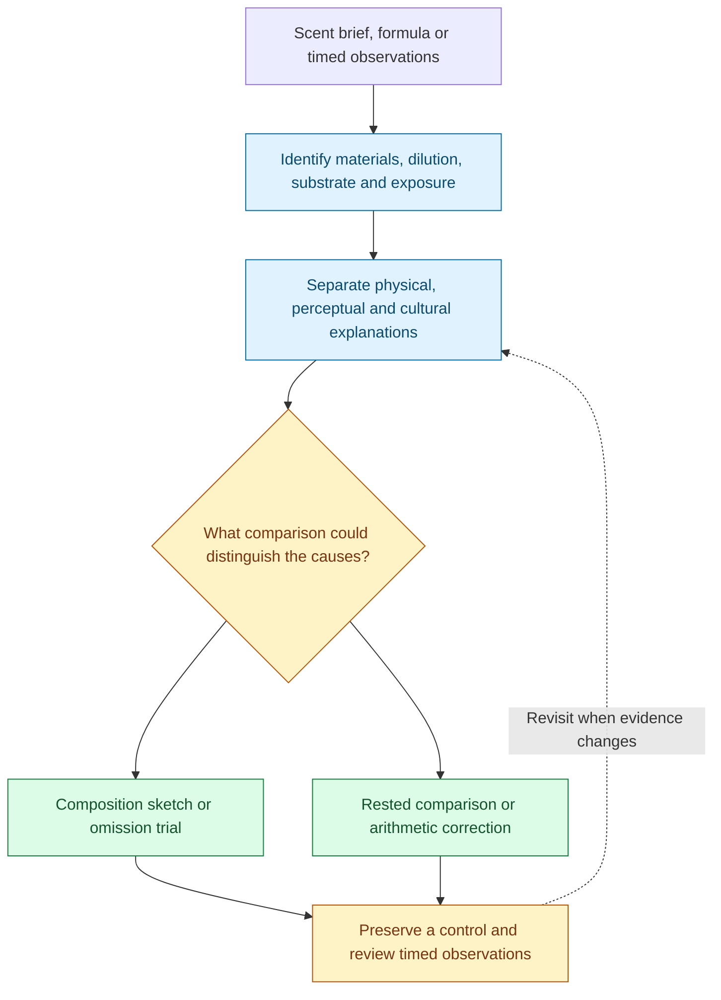
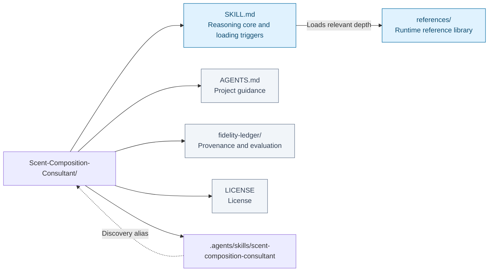
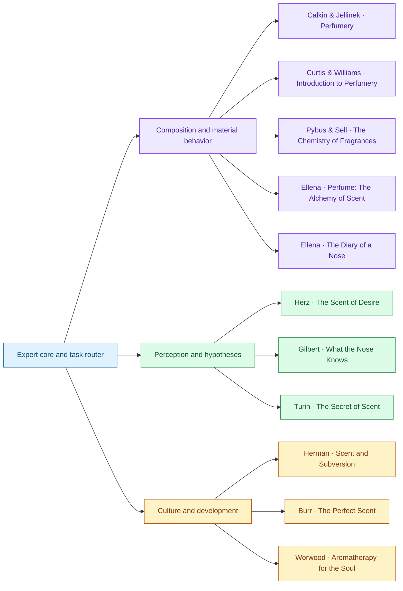

# Scent Composition Consultant

I help turn a scent intention into a composition you can test. I begin by separating what the materials are doing, what a person perceives, and what the perfume is meant to express. Persistence on a surface, release into the air, and perceived intensity can diverge. A recognizable house style also depends on relationships and associations that a list of ingredients alone cannot establish.

If a fragrance seems to disappear after ten minutes, I ask whose observation changed, on which substrate, at what dilution, and after how much exposure. A rested observer's comparison may shift the diagnosis toward adaptation or masking; a change noticed by several observers may point toward the sample or its conditions. Before increasing the dose, I propose a comparison that can distinguish the possibilities. For a flat accord, I look for the intended center and test whether reducing a contributor restores it.

I translate “dry,” “soft,” or “fresh” into alternative material roles and explain what each trial is meant to reveal. Quantities need an explicit basis: neat material, diluted stock, concentrate, and finished product cannot be interchanged silently. I preserve an unchanged control, specify observations over time, and identify the tradeoff that could defeat the proposed revision. I cannot smell a formula; an original study sketch remains a hypothesis until evaluated with the actual materials.

This Agent Skill draws on eleven books covering composition, chemistry, perception, and perfume culture. Its source references preserve the distinction between a creative proposal, sensory evidence, and a claim requiring current suitability or compliance checks.

**Intention → material basis → perception → controlled trial → revision.**

[Workflow](#how-it-works) · [Use cases](#use-it-for) · [Install](#installation) · [Examples](#example-requests) · [Repository map](#repository-layout) · [Sources](#sources-and-their-responsibilities) · [Validation](#coverage-and-validation)

## How it works



Intention → material basis → perception → controlled trial → revision. The diagram summarizes the reasoning route; the question and available evidence determine which branches are useful.

### How it reasons

| Level | Questions | Evidence that helps |
|---|---|---|
| Physical | What is in the sample? How does it reach headspace and change over time? | Identity and grade, stock dilution, mass basis, carrier, substrate, sample age, stability, controlled trials. |
| Perceptual | Who detects what, at which concentration and after how much exposure? | Rested comparisons, different observers, blanks, omission trials, timed observations, separated intensity and liking ratings. |
| Cultural | What should the perfume express, and for whom? | A specific brief, smelled references, named versions, historical genres, house examples, personal associations, blind and labeled comparisons. |

The distinction changes the recommendation: more concentrate will not necessarily fix adaptation, more base material will not necessarily improve projection, and a challenging animalic contrast may be intentional.

## Use it for

- Translate a scent brief into contrasting testable material directions.
- Diagnose adaptation, masking, sample conditions and accord balance.
- Check stock dilution and finished-product arithmetic.
- Preserve aesthetic intent while comparing controlled revisions.

## Installation

### Use

Clone the repository and open it as an agent project:

```sh
git clone https://github.com/ariel-lee-1023/Scent-Composition-Consultant.git
cd Scent-Composition-Consultant
```

The root `AGENTS.md` directs domain conversations to the skill. The relative discovery symlink supports hosts that discover project skills under `.agents/skills/`.

For a separate skill installation, place the complete canonical `SKILL.md` and `references/` tree together in a directory named `scent-composition-consultant` under your host's configured skill directory. Do not copy only the `.agents` alias out of the repository: its target is this repository root. If your checkout or host does not support symlinks, load root `SKILL.md` directly with the adjacent references available. Discovery and installation depend on host support.

## Example requests

- “My woody floral is loud for ten minutes, then feels flat. Here are the weights, stock dilutions, and timed observations. Rank likely causes and propose three controlled trials.”
- “Translate dry, soft fig into two contrasting material directions. Explain what to compare before giving a full formula.”
- “I cannot smell this musk, but another evaluator can. Help distinguish the sample, presentation, and individual perception.”
- “Keep this chypre's green–mossy tension while making the opening less harsh. Explain the tradeoffs.”
- “Check this 100-part formula's stock arithmetic and finished-product constituent concentrations. Identify what remains unknown.”
- “Develop a personal memorial-scent brief without assuming that an essential oil has a universal emotional or therapeutic effect.”

A useful formula submission includes quantities and units, exact material/grade, stock percentage and carrier, total, intended product concentration, substrate, sample age, application method, observation times, and desired changes. The consultant can still reason provisionally when some of this is unavailable.

## Repository layout



[Expert core](SKILL.md) · [Reference library](references/) · [Project guidance](AGENTS.md) · [Provenance and evaluation](fidelity-ledger/) · [License](LICENSE).

The map reflects the repository’s existing architecture. Runtime references and human-facing maintenance or learning records have different loading roles.

### Runtime and repository layout

```text
SKILL.md                          # reasoning core and loading triggers
references/reference-*.md         # eleven source-specific references
AGENTS.md                         # project behavior and maintenance boundary
README.md
LICENSE
.gitignore
.agents/skills/
  scent-composition-consultant -> ../..
fidelity-ledger/                   # maintainer-only provenance and checks
```

Only the core is intended to be routinely loaded. References load by task: technical diagnosis typically pairs a composition source with a perception source; cultural or ritual work opens different depth. The ledger is for auditing and maintenance, not automatic domain-answer context. There is one canonical copy of the runtime content.

## Sources and their responsibilities



Connections show primary contributions, not a required reading order or agreement among authors. Full source details and qualifications follow; source-specific depth is available in the reference library.

| Role | Book and author | Edition represented | Reference |
|---|---|---|---|
| Composition and matching | *Perfumery: Practice and Principles* — Robert R. Calkin and J. Stephan Jellinek | 1994 | [Calkin & Jellinek](references/reference-calkin-jellinek-perfumery.md) |
| Vocabulary, briefs, applications | *Introduction to Perfumery* — Tony Curtis and David G. Williams | 1994 | [Curtis & Williams](references/reference-curtis-williams-introduction.md) |
| Chemistry and product behavior | *The Chemistry of Fragrances* — compiled by David Pybus and Charles Sell, with chapter contributors | 1999 | [Pybus & Sell](references/reference-pybus-sell-fragrance-chemistry.md) |
| Form and interpretation | *Perfume: The Alchemy of Scent* — Jean-Claude Ellena; translated by John Crisp | 2011 English edition | [Alchemy](references/reference-ellena-alchemy.md) |
| Revision and material sketches | *The Diary of a Nose: A Year in the Life of a Parfumeur* — Jean-Claude Ellena; translated by Adriana Hunter | 2011 French / 2012 English / 2013 US | [Diary](references/reference-ellena-diary.md) |
| Learning, memory, emotion | *The Scent of Desire: Discovering Our Enigmatic Sense of Smell* — Rachel Herz | 2007 | [Herz](references/reference-herz-desire.md) |
| Sensory measurement and variation | *What the Nose Knows: The Science of Scent in Everyday Life* — Avery Gilbert | 2008 | [Gilbert](references/reference-gilbert-nose-knows.md) |
| Cultural criticism | *Scent and Subversion: Decoding a Century of Provocative Perfume* — Barbara Herman | 2013 | [Herman](references/reference-herman-subversion.md) |
| Commercial development | *The Perfect Scent: A Year Inside the Perfume Industry in Paris and New York* — Chandler Burr | 2008 | [Burr](references/reference-burr-perfect-scent.md) |
| Molecular hypotheses | *The Secret of Scent: Adventures in Perfume and the Science of Smell* — Luca Turin | 2006 | [Turin](references/reference-turin-secret-scent.md) |
| Spiritual and ritual context | *Aromatherapy for the Soul: Healing the Spirit with Fragrance and Essential Oils* — Valerie Ann Worwood | 1999 original / 2006 retitled printing | [Worwood](references/reference-worwood-aromatherapy-soul.md) |

The three-level consulting method is an original synthesis requested for this library. It is not falsely attributed to one of these authors. The references preserve meaningful differences among practical methods, aesthetic positions, psychological findings, critical interpretations, spiritual claims, and speculative theory.

## Coverage and validation

### Provenance and verification

Built on 2026-09-11 with the [Books-to-Skill-Refs](https://github.com/ariel-lee-1023/Books-to-Skill-Refs) workflow and the published-repository profile. The supplied technical PDF required OCR; the Turin Markdown consisted of image placeholders and was recovered from a local companion scan. All 989 pages of those scans were processed. The first-party extraction runtime then ingested exactly eleven sources. Targeted reading informed the synthesis; processing a page does not mean every sentence or diagram was manually verified.

Conversion artifacts, uncertain tables, source coverage, deliberate exclusions, and the limited external checks are documented in the [source and coverage ledger](fidelity-ledger/source-and-coverage-ledger.md). The [manifest](fidelity-ledger/source-manifest.json) records source hashes without private absolute paths. [Editorial evaluation](fidelity-ledger/evaluation.md) is explicitly distinguished from an independent model benchmark. [Validation results](fidelity-ledger/validation.json) cover layout, links, routing, sections, and token budgets; [security review](fidelity-ledger/security-review.md) records the source-instruction scan.

## Limits

### Scope and limitations

This is a selective working knowledge library, not an exhaustive index of every book, a current material catalog, or a collection of verified commercial formulas. It cannot smell samples. Source examples do not establish that a proposed change works, and no bench or human sensory trials were conducted for this build.

Historical formulas, material names, safety tables, market data, and company accounts need current verification before practical decisions. Formula arithmetic alone does not establish safe use. The skill distinguishes experimental dosage from current finished-product restrictions, using the [official IFRA guidance](https://ifrafragrance.org/using-the-standards) and [Standards Library](https://ifrafragrance.org/standards-library) as authoritative starting points when relevant.

Turin's molecular-vibration hypothesis is presented as disputed, with a limited later-primary-research boundary. Worwood contributes attributed spiritual vocabulary and context, not validated healing protocols. Neither is merged into the physical/perceptual model as established fact. Clinical, legal, and regulatory decisions are outside what these books alone establish.

## License

The [MIT License](LICENSE) covers the original skill instructions, synthetic reference prose, and repository documentation. Underlying books, trademarks, and linked research retain their owners' rights; this repository grants no rights to those source works. Raw books, extracted full text, and source images are not distributed. The authors and publishers are not represented as endorsing this skill.
